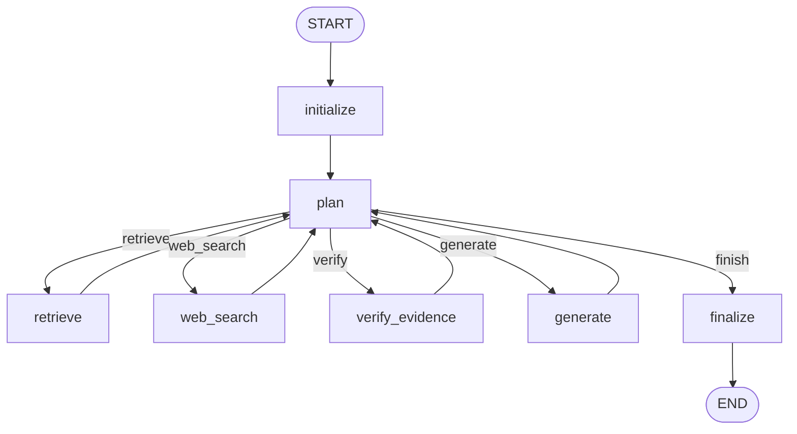

# TrafficRAG Agentic workflow

This package adds a bounded LangGraph orchestration layer around the existing
`TrafficHybridRetriever`, `LegalAnswerGenerator`, and Tavily. It does not
reimplement retrieval or generation.



The planner is deterministic and may select only the `Action` enum values.
After retrieval or web search, an evidence revision forces verification before
another decision. The default budgets are 8 planner iterations, 4 component
calls, and 1 Tavily search. They are fields on `AgentConfig` so experiments can
vary them. `DeterministicPlanner` is injected into the graph, so a validated LLM
planner can replace it later without changing nodes or edges.

If the deterministic verifier accepts evidence but the grounded generator
refuses it, the refusal becomes a structured `GENERATOR_REFUSED` signal. The
planner then performs one bounded Tavily recovery, verifies the new evidence,
and may generate once more instead of terminating immediately.

The generation prompt requires exactly `INSUFFICIENT_EVIDENCE` when context
cannot answer any requested part, including relevant evidence that lacks a
necessary amount, condition, date, or legal cross-reference. Partial answers
are deferred to recovery. The generator recognizes this exact token (or the
fixed Vietnamese refusal message), exposes `refused=True`, and converts the
token to a Vietnamese message for callers. Each `generate()` makes one model
call. Missing or unknown source IDs become `GENERATOR_CITATION_INVALID`, which
the planner may recover through the existing bounded web step. The generator
does not guess refusals from prose or make a hidden citation-repair call.

Evidence stays normalized as structured dictionaries with content, source
type, source identity, URL, score, and metadata. The initial verifier checks
lexical query coverage, retriever/Tavily relevance scores, authoritative source
availability, explicit conflict markers, freshness requirements, and exact
dates for dated operational events. A static internal corpus cannot by itself
prove a "latest" claim, while evidence about the same event on another date is
reported as `TEMPORAL_MISMATCH`. The verifier is injectable so an LLM or hybrid
implementation can replace it without graph changes.

All evidence remains in state for auditing. Retrieval keeps the original user
query and can run one bounded, corpus-oriented expansion. The normal generator
rewrites everyday wording into a formal search query; adapters without that
capability fall back to pseudo-relevance feedback extracted from the first
retrieval. Neither path contains offence-, vehicle-, article-, or document-
specific rules.

Because sibling enrichment may expand `top_k=10` into many related chunks,
generation uses a bounded relevance-and-diversity selection
(`max_generation_evidence`, default 30). It follows explicit legal
cross-references for at most two hops and treats the configured limit as a
ceiling rather than padding the context with unrelated chunks.

Every node appends an observable event to `execution_trace`, including node,
selected action, decision code, latency, counters, evidence count, and errors.
The trace intentionally contains no hidden model reasoning.

## Node responsibilities

- `initialize`: validates the query and creates a fresh state and trace.
- `plan`: chooses one enum action from the current observations and budgets.
- `retrieve`: runs original/expanded queries, adapts results, and deduplicates
  them while promoting direct hits over sibling-only copies.
- `web_search`: builds a recovery query and asks Tavily, preferring official
  Vietnamese government domains.
- `verify_evidence`: scores relevance, coverage, authority, and conflicts.
- `generate`: adapts normalized evidence to `LegalAnswerGenerator.generate`.
- `finalize`: creates a valid terminal response and machine-readable reason.

## Files

- `state.py`: `AgentState`, normalized `Evidence`, actions, and stop reasons.
- `config.py`: budgets, thresholds, and preferred web domains.
- `planner.py`: replaceable deterministic controller.
- `evidence.py`: adapters, deduplication, and baseline verifier.
- `web_search.py`: Tavily execution component.
- `workflow.py`: nodes, conditional edges, tracing, and facade.
- `example.py`: end-to-end command-line example.

## Run

Install dependencies and configure the existing Qdrant/generator variables plus
`TAVILY_API_KEY` in `.env`:

```powershell
pip install -r requirements.txt
python -m Sources.agentic_rag.example "Ô tô vượt đèn đỏ bị phạt bao nhiêu?"
```

To select GPT-6 Luna explicitly (requires `OPENAI_API_KEY`):

```powershell
python -m Sources.agentic_rag.example "Ô tô vượt đèn đỏ bị phạt bao nhiêu?" --provider openai --model gpt-6-luna --reasoning-effort low --max-tokens 4096
```

The same provider/model flags are available on the benchmark query and collect
commands. Environment equivalents are `GENERATOR_PROVIDER`, `GENERATOR_MODEL`,
`GENERATOR_REASONING_EFFORT`, and `GENERATOR_MAX_TOKENS`. Luna uses Responses
without a temperature parameter; the token limit includes reasoning tokens.

The command prints a compact answer and metrics object. Add `--debug` to print
the complete state, including normalized evidence and the execution trace.

The returned state exposes `final_answer`, `final_sources`, `stop_reason`,
`execution_trace`, `tool_calls`, `retrieval_calls`, `query_expansion_calls`,
`generation_model_calls`, `web_searches`, `iteration`, and `total_latency_ms`,
making baseline-versus-agent experiments straightforward.

Each generation context block has a stable `SOURCE_ID` (`S1`, `S2`, ...).
Answers cite `[S#]`; internal sources additionally cite their legal location,
while web citations are deterministically rendered from trusted metadata as
`[S# — hostname](URL)`. Web records also expose `domain`. Generator output
includes `answer_status`, `citation_valid`, and `citation_issues`, and
`final_sources` contains the resolved metadata instead of relying on ambiguous
labels such as `[Nguồn 4]`.

Runtime citation validation checks that cited source IDs exist and resolves
their metadata. Internal answer text and legal locators remain as generated;
the runtime does not infer sources from bare legal locators, fill document
identifiers, or parse legal support chains. Grounding and citation correctness
are judged separately by the evaluation package. Both runners use the same
generator. Evaluation code is never imported by the runtime pipeline.

## Tests

```powershell
python -m unittest discover -s test -p "test_*.py"
```

The Agentic RAG tests use fake components and do not call Qdrant, an LLM, or
Tavily.
